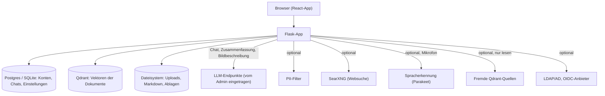

# Data Mapping

Technische Bestandsaufnahme der Datenflüsse (Stand 2026-10-12, Version 0.1.3); Ausgangspunkt für Art. 30 (VVT) und Art. 35 (DSFA) DSGVO. Keine Rechtsberatung. Die Einstufung (Auftragsverarbeiter, Drittland) hängt davon ab, **welche LLM-Endpunkte, Suchdienste und externen Quellen der Betreiber einträgt**.

## Systemübersicht

## Datenkategorien

| Kategorie | Beispiele | Wo im System |
|---|---|---|
| Nutzerkonten | Benutzername, Anzeigename, Rolle, Anmeldequelle, bei LDAP/OIDC die gemeldeten Gruppennamen | Tabelle `users` (`app/models.py`), `group_members` |
| Zugangsdaten | Passwort-Hash (lokal), API-Keys der Verbindungen, LDAP-Bind-Passwort, OIDC-Secret, Quellen-Keys | `users.password_hash`, `connections`, `settings` (sensibel markiert, **nicht verschlüsselt**) |
| Chatinhalte | Fragen, Antworten, Quellenangaben, Zusammenfassung des Verlaufs | `messages`, `sessions.summary` |
| Dokumente | Hochgeladene Dateien, daraus erzeugtes Markdown, Chunks, Embeddings, Bildbeschreibungen | Dateisystem (`DATA_DIR`), Qdrant, `user_documents`, `chat_attachments` |
| Ablagen ("Meine Ablagen") | Vom Nutzer abgelegte Markdown-Dateien pro Nutzer | `user_summary_files` |
| Audio | Mikrofon-Stream für Diktat | nur durchgereicht an den STT-Dienst; im Code keine Speicherung gefunden (`app/stt_stream.py`) |
| SQL-Wertverzeichnis | Verschiedene Werte ausgewählter Textspalten mit Häufigkeit (Klartext, keine Zeilen) | Tabelle `sql_values` (`app/sqlsource/valueindex.py`); gelöscht mit der SQL-Quelle |
| SQL-Quellen | Zugangsdaten (Host, Benutzer, Passwort), Tabellen-/Spaltenfreigaben; Abfrageergebnisse nur im laufenden Request | `knowledge.source_config` (Passwort **nicht verschlüsselt**, nie in API-Antworten); Ergebnisse werden nicht gespeichert, nur als Teil der Chatantwort |
| Inhalte können alles enthalten | Die Dokumente und Fragen der Nutzer können personenbezogene oder besondere Kategorien (Art. 9) enthalten; das System unterscheidet sie nicht | alle obigen |

## Verarbeitungsschritte im Detail

| # | Schritt | Daten | Ziel/Empfänger | Code-Referenz |
|---|---|---|---|---|
| 1 | Anmeldung lokal | Benutzername, Passwort | App/DB | `app/users.py:authenticate` |
| 2 | Anmeldung LDAP | Benutzername, Passwort | LDAP-Server des Betreibers | `app/auth_ldap.py` |
| 3 | Anmeldung OIDC | ID-Token-Claims (Name, Gruppen) | OIDC-Anbieter | `app/auth_oidc.py`, `app/auth_external.py` |
| 4 | Dokument hochladen und einlesen | Datei, Text, Bilder | Dateisystem, Qdrant; Bildbeschreibung und Kontext-Anreicherung ggf. LLM | `app/ingest/`, `app/vector/ingestion.py` |
| 5 | Chatfrage | Frage, Anhangsnamen | optional PII-Filter, danach Embedding, Qdrant, LLM | `app/routes.py` (Chat-Route), `app/utils/pii_filter_client.py` |
| 6 | Websuche (pro Modell zuschaltbar) | Suchanfrage, mit PII-Filter maskiert; ohne Filter nur nach ausdrücklicher Freigabe (`SEARCH_ALLOW_UNMASKED`) unmaskiert | SearXNG, und von dort Suchmaschinen | `app/tools/web_search_tool.py`, `app/tools/web_access.py` |
| 7 | Compaction | älterer Verlauf | LLM des Chat-Modells; Ergebnis in `sessions.summary` | `app/compaction.py` |
| 8 | Externe Quelle | Frage-Embedding, Filter (Benutzer/Gruppen) | Fremder Qdrant | `app/vector/sources.py` |
| 9 | Diktat | Audio | STT-Dienst | `app/stt_stream.py` |
| 10 | SQL-Datenbank als Knowledge | SELECT-Abfragen des Modells, Ergebnistabellen (begrenzt), Schema; mit PII-Filter maskiert, sonst unverändert | Fremde Datenbank über den SQL-Worker (`tool-worker-sql`); Ergebnis an das LLM | `app/sqlsource/`, `tool_worker/sqlengine.py` |

## Verschlüsselung

- **At rest:** keine Verschlüsselung auf Anwendungsebene. Datenbank, Dateien und Qdrant liegen im Klartext. Plattenverschlüsselung (LUKS, Volume-Verschlüsselung) liegt beim Betreiber.
- **In transit:** App selbst spricht HTTP; TLS über den Reverse Proxy des Betreibers (`SECURITY.md`). Ausgehende URLs (LLM, Qdrant, Suche, STT, LDAP) sind frei wählbar, `http://` ist erlaubt. LDAP prüft Zertifikate (`app/auth_ldap.py`), Adressen im Link-Local-Bereich sind gesperrt (`app/llm/registry.py:_reject_link_local`).
- **Fehlerverhalten:** Es gibt keinen Schlüssel, der fehlen könnte; Zugangsdaten stehen im Klartext in der DB.

## Aufbewahrung und Löschung

| Daten | Dauer | Wer löscht | Automatisch? |
|---|---|---|---|
| Chats und Nachrichten | unbegrenzt | Nutzer (`delete_session_route`) oder Admin beim Löschen des Benutzers (`app/user_admin.py:delete_user`) | nein |
| Chat-Anhänge | mit dem Chat | `app/attachments.py:cleanup_session_attachments` | beim Löschen des Chats |
| Eigene Dokumente | unbegrenzt | Nutzer (`app/user_routes.py:delete_my_document`) | nein |
| Zusammenfassung des Verlaufs | mit dem Chat | gelöscht mit der Session | beim Löschen |
| Konten | unbegrenzt | Admin | nein |
| Backups | betreiberabhängig | Betreiber | - |

## Betroffenenrechte

| Recht | Weg im Produkt |
|---|---|
| Auskunft / Übertragbarkeit | **kein Export** vorhanden (Lücke); manuell über die DB |
| Berichtigung | Anzeigename und Passwort in den Kontoeinstellungen; Admin über die Benutzerverwaltung |
| Löschung | siehe Tabelle oben; Backups und LLM-/Suchdienst-Protokolle des Betreibers gesondert |
| Widerspruch | Betreiberprozess (Konto deaktivieren oder löschen) |

## Externe Stellen

Nur die vom Betreiber konfigurierten: LLM-Verbindungen (*Administration › Verbindungen*), PII-Filter, SearXNG, STT, LDAP/OIDC, fremde Qdrant-Quellen (*Tools*, *Authentifizierung*, *Knowledge › Externe Quelle*). Keine Annahmen über Drittländer: wer einen Cloud-Endpunkt einträgt, überträgt Frage und Fundstellen dorthin und braucht dafür einen Vertrag nach Art. 28 und ggf. eine Drittlandgrundlage.

## Bekannte Lücken

1. Keine Verschlüsselung at rest und keine Schlüsselrotation für Zugangsdaten.
2. Kein Audit-Log und keine automatische Aufbewahrungsfrist.
3. Kein Datenexport für Auskunft/Übertragbarkeit.
4. Der PII-Filter maskiert nur Nutzereingaben; Dokumentinhalte, die per Suche ins LLM gelangen, werden nicht maskiert. Bei einem Fehler des Filters bricht der **Chat** mit einer Fehlermeldung ab (`app/routes.py`, `mask_or_fail`) und die **Websuche** ebenso (`app/tools/web_search_tool.py`); es geht nichts unmaskiert hinaus. Der Chat maskiert den **ganzen Kontext** (Zusammenfassung, Verlauf, neue Frage) in einem Aufruf (`app/pii_session.py`); auch das Zusammenfassungs-Modell der Compaction sieht nur maskierten Text. Gespeichert wird weiterhin Klartext. **Bleibende Lücken:** Dokument-Treffer (Ergebnisse der Dokumentsuche) und Inhalte des Wissens gehen unmaskiert an das Modell; Suchanfragen des Modells enthalten Platzhalter statt Namen. Mit der Freigabe "ohne PII-Filter" verlassen Suchanfragen das System unmaskiert.
5. `delete_user` (`app/user_admin.py:161`) entfernt Chats, Nachrichten, Gruppenmitgliedschaften, Freigaben und das Konto, die Anhänge der Chats räumt die Route danach auf. Uploads unter *Meine Uploads* und Ablagen des Benutzers werden dort **nicht ausdrücklich** gelöscht (nicht abschließend geprüft, ob sie anderweitig mit entfallen). Vor Produktivbetrieb klären.
